# Urban Scenery Ventures — UI & UX Interface Blueprint

This directory contains the visual references and documentation for all **16 interfaces** implemented in the frontend application.

- **Primary Brand Color**: Magenta Pink (`#E6007E`)
- **Accent Brand Color**: Golden Yellow (`#FFB800`)
- **Backend Grounding**: FastAPI (`https://agentic-connexa-backend.onrender.com/docs`)
- **Design Foundations**: Reference layouts from TechVerse & NovaShop modern e-commerce systems

---

## 🎨 16 Interfaces Index

### 1. Storefront Interfaces
| # | Interface | File | React Component | Live Endpoints |
|---|---|---|---|---|
| **01** | Storefront Home (Light Mode) | `01_storefront_home_light.png` | `src/components/storefront/HeroBanner.tsx` | `GET /api/v1/products` |
| **02** | Storefront Home (Dark Mode) | `02_storefront_home_dark.png` | `src/store/useThemeStore.ts` | Dynamic theme state |
| **03** | Product Catalog Grid & Filters | `03_product_catalog.png` | `src/components/storefront/ProductGrid.tsx` | `GET /api/v1/products?search=...` |

### 2. Purchase Funnel & Authentication
| # | Interface | File | React Component | Live Endpoints |
|---|---|---|---|---|
| **04** | AI Hardware Recommendation Modal | `04_ai_recommendation_modal.png` | `src/components/storefront/AiRecommendationModal.tsx` | `POST /api/v1/ai/recommend` |
| **05** | Slide-Over Cart Drawer | `05_cart_drawer.png` | `src/components/storefront/CartDrawer.tsx` | `GET /api/v1/products` (cross-sells) |
| **06** | Multi-Rail Checkout & Payment | `06_checkout_modal.png` | `src/components/storefront/CheckoutModal.tsx` | `POST /api/v1/orders` `POST /api/v1/payments/pay` |
| **07** | Customer & Admin Authentication | `07_auth_modal.png` | `src/components/auth/AuthModal.tsx` | `POST /api/v1/auth/login` `POST /api/v1/auth/register` |

### 3. Artificial Intelligence Tools
| # | Interface | File | React Component | Live Endpoints |
|---|---|---|---|---|
| **08** | Floating AI Shopping Assistant | `08_ai_shopping_assistant.png` | `src/components/storefront/AiShoppingAssistant.tsx` | `POST /api/v1/ai/agents/customer-shopping-assistant` |

### 4. Merchant & Admin Dashboard
| # | Interface | File | React Component | Live Endpoints |
|---|---|---|---|---|
| **09** | Admin Authentication Gate | `09_admin_auth_gate.png` | `src/components/admin/AdminDashboard.tsx` | Role verification |
| **10** | Admin Dashboard: Overview | `10_admin_overview.png` | `src/components/admin/AdminDashboard.tsx` | `GET /orders`, `GET /products`, `GET /payments` |
| **11** | Admin Dashboard: Products Inventory | `11_admin_products.png` | `src/components/admin/AdminDashboard.tsx` | `GET/POST/PUT/DELETE /api/v1/products` |
| **12** | Admin Dashboard: Customers Management | `12_admin_customers.png` | `src/components/admin/AdminDashboard.tsx` | `GET/PUT/DELETE /api/v1/users` |
| **13** | Admin Dashboard: Orders Fulfillment | `13_admin_orders.png` | `src/components/admin/AdminDashboard.tsx` | `GET /orders`, `PATCH /orders/{id}/status` |
| **14** | Admin Dashboard: Multi-Rail Payments | `14_admin_payments.png` | `src/components/admin/AdminDashboard.tsx` | `GET /api/v1/payments` |
| **15** | Admin Dashboard: AI Enterprise Studio | `15_admin_ai_studio.png` | `src/components/admin/AdminDashboard.tsx` | `POST /api/v1/ai/agents/*` |
| **16** | Admin Dashboard: Multichannel Hub | `16_admin_platforms.png` | `src/components/admin/AdminDashboard.tsx` | `GET /platforms/status` `POST /platforms/*` |

---

## 🖼️ Visual Showcase

### 01. Storefront Homepage (Light Mode)
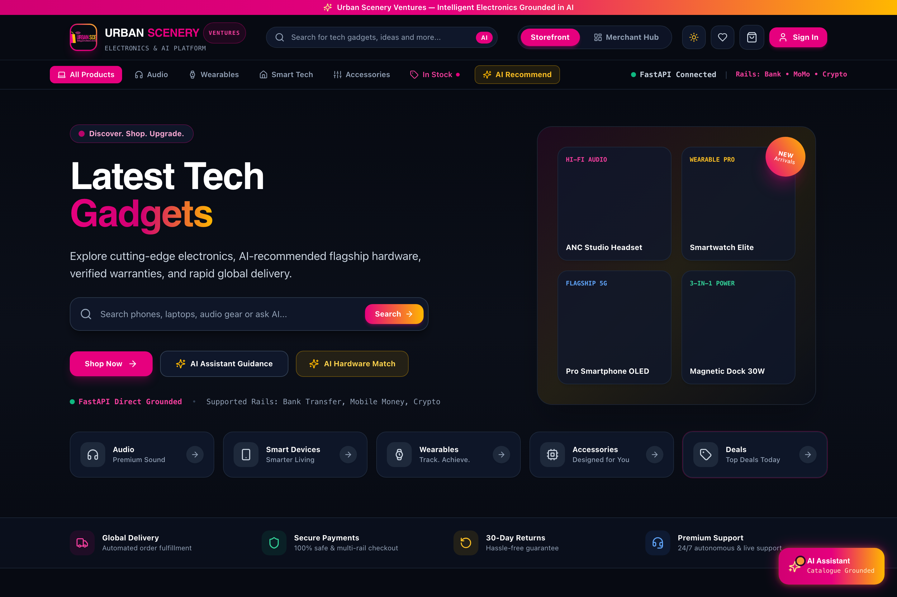

### 02. Storefront Homepage (Dark Mode)
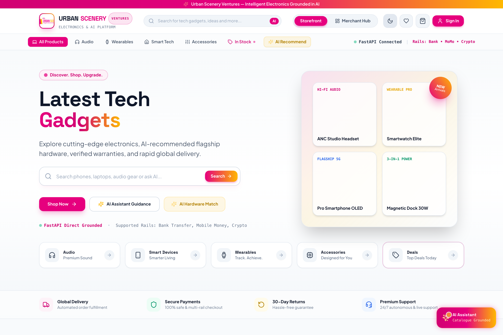

### 03. Product Catalog Grid & Filters
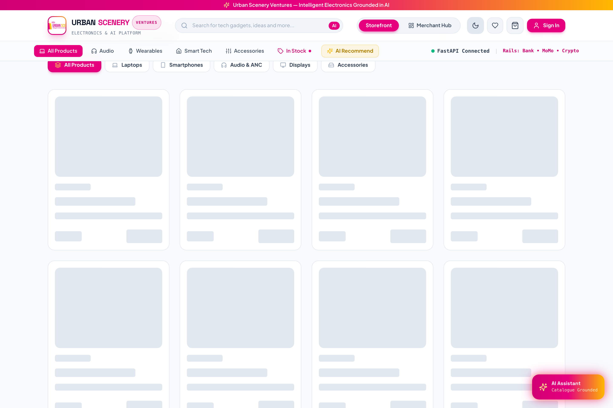

### 04. AI Hardware Recommendation Engine Modal
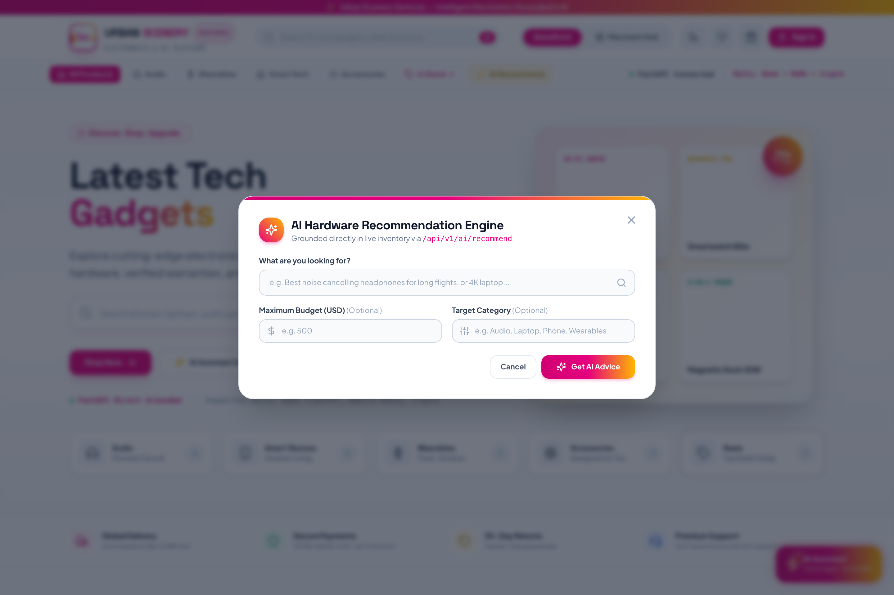

### 05. Slide-Over Cart Drawer
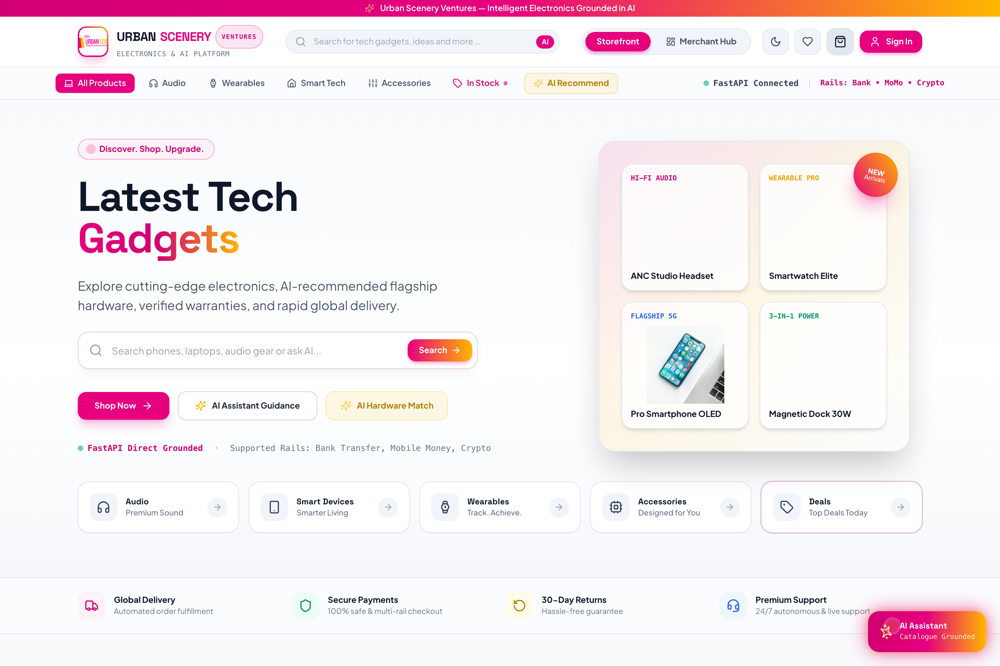

### 06. Multi-Rail Checkout & Payment Modal

### 07. Customer & Admin Authentication Modal
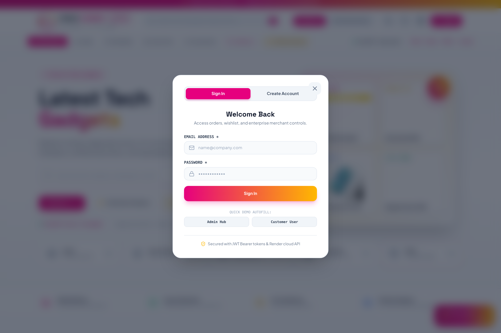

### 08. Floating AI Shopping Assistant
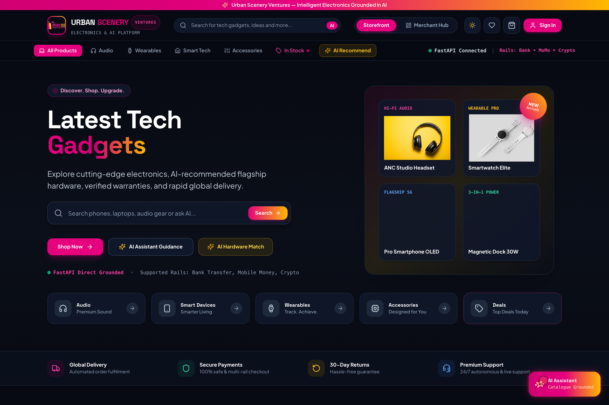

### 09. Admin Authentication Gate
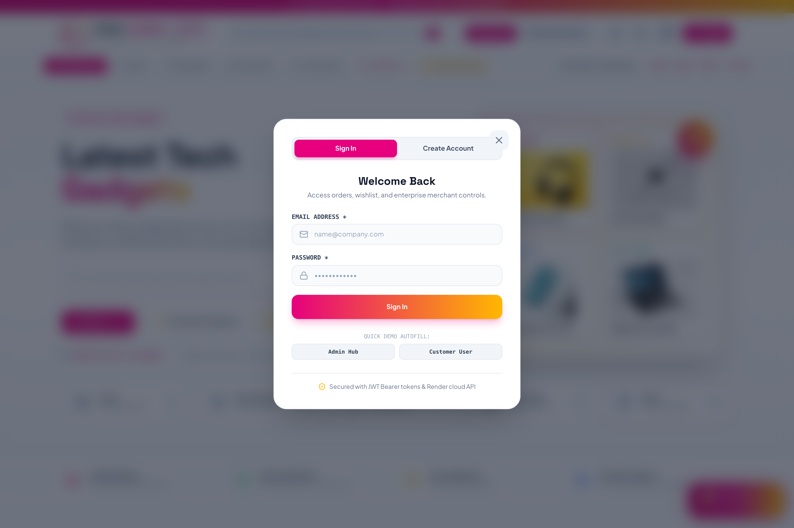

### 10. Admin Overview Dashboard
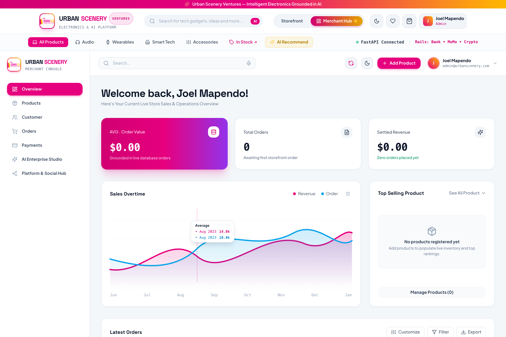

### 11. Admin Products Inventory Management
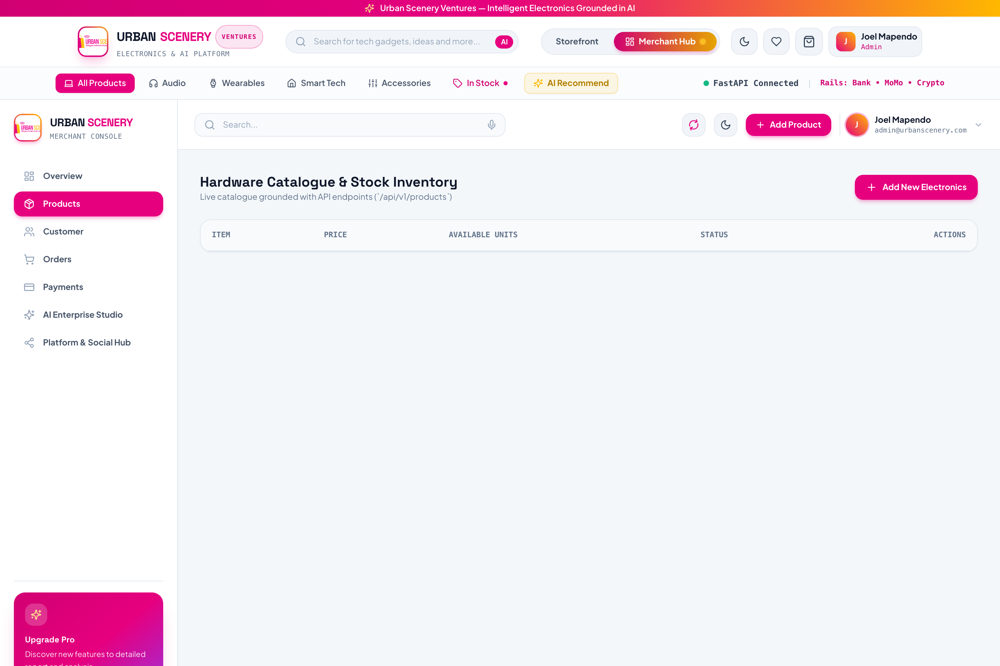

### 12. Admin Customers Management
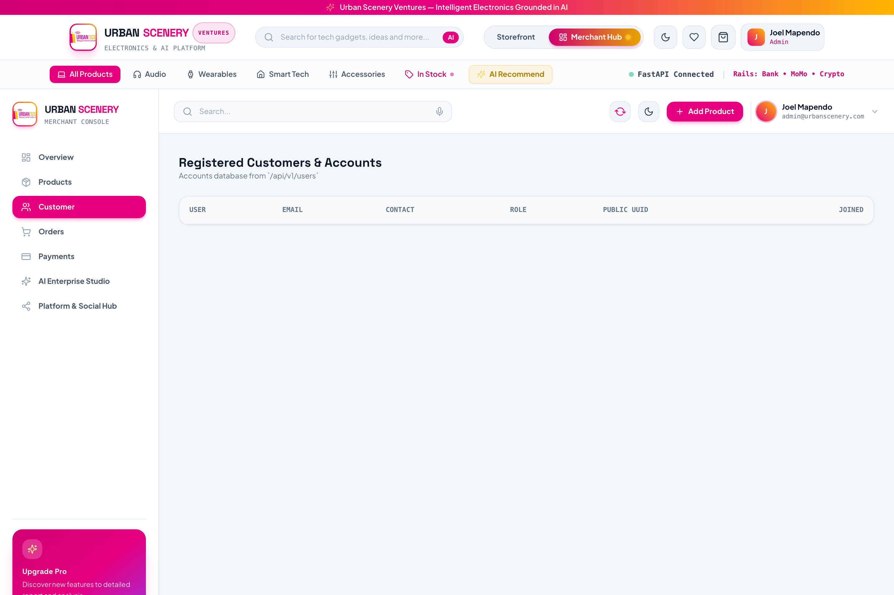

### 13. Admin Orders Fulfillment Pipeline
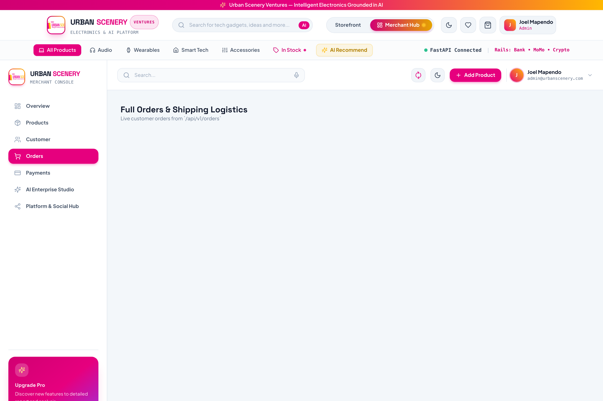

### 14. Admin Multi-Rail Payments Audit Ledger
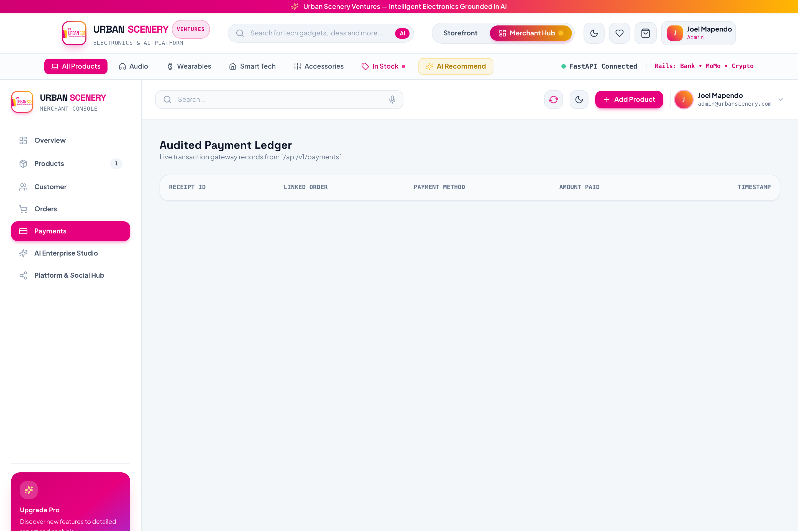

### 15. Admin AI Enterprise Studio
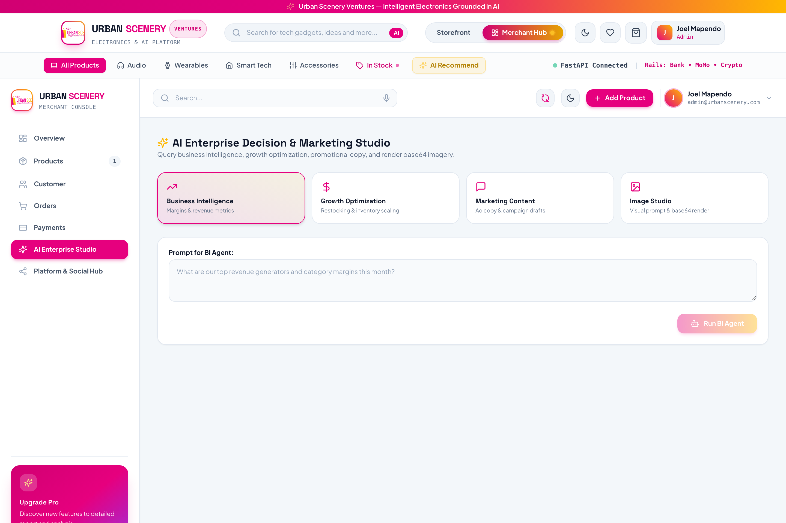

### 16. Admin Multichannel Social & WhatsApp Hub
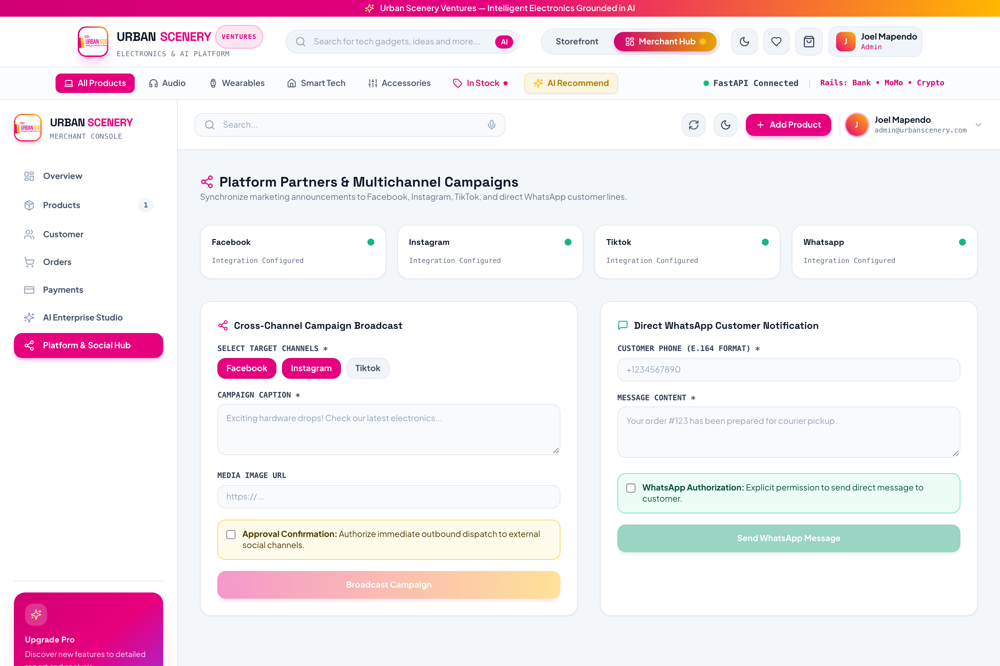
